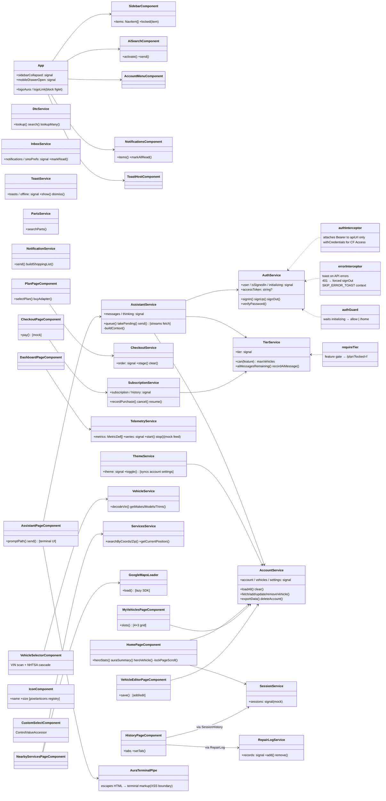
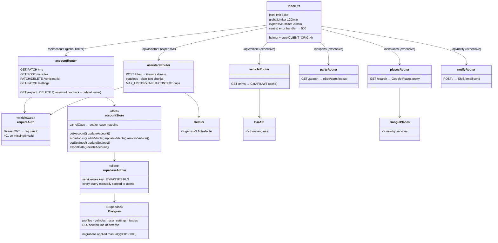

# AuraLink — Architecture UML

_Mermaid class diagrams. Render in any Mermaid-aware viewer (GitHub, VS Code)._
_Generated 2026-07-12 from the current source; regenerate when the shape changes._

## Client (Angular 21)

## Server (Express)

## Data flow (one line)

`Angular (signals) → authInterceptor (Bearer, apiUrl-only) → Express (helmet/CORS/rate limits) → requireAuth (JWT → userId) → accountStore (userId-scoped) → supabaseAdmin (service role) → Postgres (RLS backstop)` — auth itself is the exception: the client talks to Supabase Auth directly (`supabase-client.ts`), and Aura streams over raw `fetch` instead of HttpClient.
